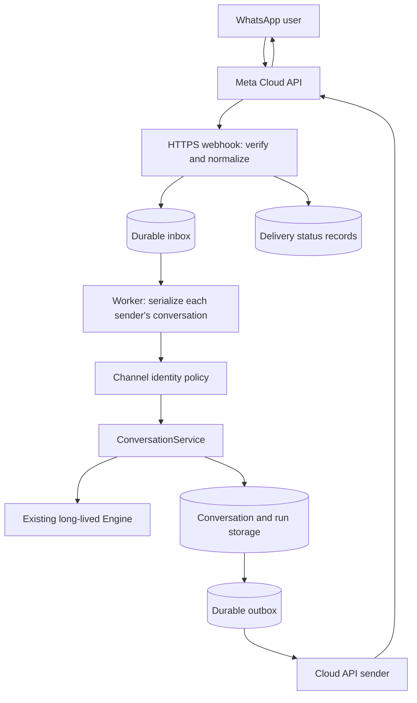

# WhatsApp integration plan

- **Status:** WA-01 preparation, WA-02 durable channel storage/identity
  boundary, WA-03 authenticated webhook intake, WA-04 turn worker/recovery,
  and WA-05 outbound delivery/controls are implemented. Organization account
  linking and live pilot setup remain pending. Intake, worker and sender are
  separately disabled by default.
- **Date:** 2026-10-15.
- **Updated:** 2026-10-16.
- **Confirmed scope:** One organization-owned WhatsApp Business number.
- **Confirmed pilot:** An assistant that needs internal organization information.
- **Identity direction:** A generic integration, later using Google login and
  an organization authentication server that issues JWTs.
- **Goal:** Let a person message that number, hold a persistent conversation with
  an Extra agent system, and receive its answer in WhatsApp.

The user approved starting implementation on 2026-10-15.
[ADR 0006](adr/0006-idempotent-conversation-turn-preparation.md) records the
WA-01 preparation contract implemented by
[task 0013](../tasks/0013-idempotent-conversation-turns.md).
[ADR 0007](adr/0007-durable-channel-identity-boundary.md) records the SQL
storage and client identity boundary implemented by
[task 0014](../tasks/0014-channel-storage-and-identity.md).
[ADR 0008](adr/0008-authenticated-whatsapp-intake.md) records authenticated
batch intake implemented by
[task 0015](../tasks/0015-whatsapp-webhook.md).
[ADR 0009](adr/0009-channel-worker-ownership-and-recovery.md) records worker
ownership and recovery implemented by
[task 0016](../tasks/0016-channel-turn-worker.md). Account preflight
remains pending: no real number, credentials, or deployment were configured.
[Task 0017](../tasks/0017-whatsapp-review-and-hardening.md) reviews these stages
and hardens caller-cancelled shutdown and persistable normalized input; see
the [implementation explanation and review](WHATSAPP_REVIEW.md).
[Task 0019](../tasks/0019-whatsapp-delivery-and-controls.md) implements delivery
and controls under [ADR 0010](adr/0010-whatsapp-outbound-delivery.md), with local
SQL/fake-provider verification. No real account was configured or contacted.
Subsequent architecture/contract changes still require scoped tasks and ADRs,
as required by [AGENTS.md](../AGENTS.md).

## 1. Recommended first release

Use Meta's **WhatsApp Cloud API** directly, with a channel adapter in
`agent_manager`. Start with one number, one configured agent system, individual
text conversations, and a single final answer per turn, split into ordered
messages when necessary. Configure the connection administratively; a customer
account-connection interface is unnecessary for this scope.

The experience is: send a text message, receive an answer, then continue with
the previous conversation as context. A deterministic `שיחה חדשה` / `/new`
command starts a fresh Extra conversation. Unsupported attachments receive a
short explanation. A `נציג` / `/help` command gives the organization's real
support contact; an agent inbox and live operator takeover are later work.

The confirmed pilot needs internal information. Complete the identity/access
work in section 5 before activating the channel. Select an
organization-specific assistant use case and check its
eligibility against the account's current Meta terms during setup; this plan
does not establish that every agent system may be distributed through WhatsApp.

### Existing implementation to reuse

| Existing component | Role in this integration |
| --- | --- |
| `agent_manager/api/app.py` | Startup composition: validate configuration and build the engine once. |
| `application/conversation_service.py` | Conversation ownership, history, turn preparation, execution, and final-answer persistence. |
| `domain/identity.py` | `Principal`, including externally resolved identities. |
| `domain/turn_preparation.py` | Optional atomic preparation capability and validated, digested retry keys (WA-01). |
| `domain/channels/` | Bounded normalized input, work states, durable repository port, and client identity resolver (WA-02). |
| `application/channels/preparation.py` | Fresh organization identity checks and recoverable manager turn preparation (WA-02). |
| `infrastructure/persistence/channels/` | Atomic SQL intake, sender claims, ordered reset, execution claims, and immutable reply staging (WA-02). |
| `api/routes/whatsapp.py`, `infrastructure/channels/whatsapp/` | Opt-in challenge/signature verification, bounded typed batch normalization, and durable intake (WA-03). |
| `domain/channels/webhooks.py`, SQL webhook adapter | Atomic callback receipts, normalized delivery observations, and safe quarantine metadata (WA-03). |
| `application/channels/{worker,processing}.py` | Bounded sender jobs, fresh execution identity, normal manager streaming, saved-answer staging, and conservative recovery (WA-04). |
| `domain/channels/ownership.py`, SQL ownership adapter | Exclusive connection supervisor; POSIX file lock for local SQLite or a dedicated PostgreSQL advisory-lock session (WA-04). |
| `application/channels/{delivery,controls}.py` | Original-recipient authorization, attempt policy, window/suppression checks, and deterministic controls (WA-05). |
| `infrastructure/channels/whatsapp/{sender,rendering}.py` | Bounded HTTPS submission and exact Unicode/grapheme-safe plain-text parts (WA-05). |
| SQL delivery/control adapters, migration 0010 | Immutable provider parts, pinned owners, CAS attempts, callback projection and suppression cutoffs (WA-05). |
| `infrastructure/persistence/` | Conversation storage, SQL run storage, and Alembic migrations. |
| `agent_engine/engine/engine.py` | Existing typed engine boundary. |
| `agent_engine/runtime/hooks/models.py` | Request-scoped `RunContext` and `AuthContext`. |

The current code supports SQL persistence and defaults to a file-backed SQLite
database in `Settings`; explicit memory configurations are also possible. Do
not infer restart durability from the package's presence alone: validate the
actual deployment settings. SQL composition exposes a channel repository;
memory-mode composition exposes none. Session approvals, tool usage, and the tool
execution ledger have process-local implementations, so durable conversations
do not imply durable tool replay or approvals.

## 2. Architecture and ownership

`agent_manager` owns the transport and conversation lifecycle. The provider
adapter normalizes WhatsApp payloads into typed channel events, and the
application layer calls `ConversationService`. It must not call an HTTP
endpoint on its own process or bypass the service and invoke `/invoke` directly.

`agent_engine` has no WhatsApp imports, provider payloads, or channel storage.
It still receives typed messages/history and a fresh request context. Agent
YAML, the compiler, model providers, prompts, and engine public ports remain
unchanged. Organization-specific account lookup and permissions live in a
client-owned identity/access plugin, behind the implemented
`ChannelIdentityResolver` port.

The implemented first worker shares one `agent-manager` process and application
service. It is separately enabled at startup and awaited during shutdown.
Bounded concurrent jobs let independent senders progress; binding claims retain
each sender's order. Database records are the work queue; an in-memory
task or FastAPI background callback is not the durable handoff. This avoids
introducing Redis, a broker, or a separate deployment for the initial number.

Recovery requires exclusive ownership of the connection. Local SQLite uses a
POSIX lock beside the canonical database path; do not delete that lock file or
use network-mounted SQLite for the worker. PostgreSQL uses a dedicated session
advisory lock with backend-session checks and autocommit; transaction-pooling
proxies are unsuitable for that ownership connection. A lost owner stops claims
and cancels/awaits its jobs. An enabled stopped worker makes `/health` return
503 with `status: degraded`; worker-disabled health behavior stays unchanged.

Shutdown retains ownership while engine cleanup finishes, including when the
lifespan caller is cancelled repeatedly. Ownership failure degrades health
before waiting for that cleanup. Normalized identifiers/text reject
NUL before SQL writes, so unpersistable authenticated items are quarantined
without discarding valid siblings in their callback.

Use PostgreSQL for the production deployment. File-backed SQLite may support a
single-process local pilot with tested transaction semantics. Multiple manager
replicas and distributed execution are a separate milestone, since current
process-local runtime repositories are insufficient for safe failover.

## 3. Incoming and outgoing message flow

1. **Verify subscription (implemented).** `GET /channels/whatsapp/webhook` checks
   `hub.mode` and the configured verification token, then returns the exact
   challenge. The verification token is distinct from the app secret and API token.
2. **Verify notification (implemented).** `POST` on that path checks the signature
   over the original request bytes using the app secret, with constant-time
   comparison. Streamed bytes are bounded before parsing, even without a
   content-length header. Invalid signatures are rejected before storage;
   unsupported encoding/content types are rejected. Meta's archived official
   reference describes the separate challenge and `X-Hub-Signature-256`
   mechanisms. [Meta webhook reference](https://whatsapp.github.io/WhatsApp-Nodejs-SDK/api-reference/webhooks/start/)
3. **Normalize the full batch (implemented).** Iterate every entry, change, and message; do
   not assume the event is at index zero. Check the configured business account
   and receiving-number identifiers. Separate inbound messages, delivery
   updates, and unsupported event types. Delivery updates never invoke an agent.
   The current explicit contract uses `whatsapp_business_account` envelopes
   and opaque message `from` identifiers. New account/BSUID payload variants
   require verified fixtures before adoption. Meta's official
   [Postman reference](https://www.postman.com/meta/whatsapp-business-platform/folder/tduohwq/webhook-payload-reference)
   confirms the wire account/number envelope.
4. **Persist, then acknowledge (implemented).** Insert inbound messages and work state in one
   transaction. Return `200` after commit, without waiting for an LLM. A duplicate
   provider message returns `200` and reuses its existing work. A temporary
   storage failure returns a retryable failure; never acknowledge unrecorded work.
   Authenticated malformed items retain a body digest and bounded reason/position
   metadata, preserving valid siblings without storing raw payloads or errors.
   Conflicting provider-message input is quarantined without rebinding its
   original target. Receipt, messages/bindings, delivery observations, and
   quarantine metadata commit in one transaction. Storage failure returns 503;
   the complete callback can be retried. Unauthenticated requests are rejected;
   unrelated accounts/events are ignored without creating a conversation.
5. **Resolve the sender and conversation (implemented).** Use an opaque provider sender ID,
   scoped to the configured connection and agent system. Do not assume it is
   always a visible phone number or merge it with a web user by matching text.
   Atomically get or create the active binding and its Extra conversation.
6. **Prepare one turn (implemented).** Persist a stable link between the inbound event and
   the manager's user message/run. The manager loads bounded prior context and
   the worker refreshes the original linked `Principal` again before the atomic
   execution claim. Roles and delegated credentials remain request-scoped.
7. **Persist the answer (implemented).** Use the manager's normal completion path, then
   create an outbox entry referring to that persisted assistant message.
   An idempotent recovery scan repairs a crash between answer persistence and
   outbox creation. A persisted answer is never regenerated to retry delivery.
   The worker currently stages one exact response part, up to 65536 UTF-8 bytes.
   Empty/missing/oversized answers stop for review. WA-05 freezes provider parts
   separately, preserving this original logical answer. With the sender enabled,
   controls and unsupported-media feedback use static replies without a model.
8. **Send and track (implemented, opt-in).** Preserve exact plain text/Unicode/RTL,
   split at grapheme boundaries with paragraph preference, and cap each part at
   4096 UTF-16 units and each batch at 128 parts. Freeze the plan once; send
   parts/turns in recipient order and persist each returned provider message ID.
   API acceptance is distinct from delivered/read callbacks. Interrupted or
   ambiguous submission is held for review; it is never blindly resent.

Target a webhook acknowledgement below one second under the agreed pilot
load. This is an internal acceptance target, not a claimed Meta timeout.

### Concurrency, ordering, and crash recovery

- A database-backed claim serializes a sender's turns through answer/outbox
  creation; a local lock alone does not establish ownership. Preserve a durable
  receive sequence within that conversation. Provider timestamps remain metadata:
  the adapter cannot guarantee the original order of late webhook arrivals.
- Preserve outbound part and turn order per recipient. Bound queue depth and
  concurrency across recipients; apply model/time/tool budgets as usual.
- `/new` is queued in the same ordering mechanism. It changes the active
  binding without deleting history or causing an older answer to attach to the
  new conversation. WhatsApp's service window does not define conversation expiry.
- Without a key, `prepare_turn()` still creates fresh random IDs. WA-01 adds
  an opt-in `idempotency_key`, backed by the optional
  `IdempotentTurnRepository` capability. Receipt, user append, head selection,
  and snapshot commit atomically. Run registration is reconciled on replay,
  and conflicting owner/conversation/content is rejected. See ADR 0006.
  Merely deduplicating webhook receipt does **not** replace that preparation
  boundary. This capability does not itself claim or authorize execution.
- On restart, queued unprepared work may proceed; a prepared turn may proceed
  only when the durable execution claim proves it has not started. Recover a
  stored answer into the outbox. An interrupted/ambiguous execution goes to
  `needs_review`, blocks later turns for that sender, and requires explicit
  reconciliation. Do not automatically rerun tools, reclaim a live execution
  because a lease expired, or infer that a `COMPLETED` run always has a stored
  assistant answer. The engine and manager currently commit those separately.
- Retry a known rejected/transient provider send with capped exponential
  backoff and jitter. On a timeout after submission, record `delivery_unknown`:
  reconcile using verified provider correlation support/status callbacks where
  available, or require operator review. Blind resends can duplicate messages.
  Do not promise exactly-once external delivery.

## 4. Storage and application seams

Migration 0008 implements `channel_bindings`, `channel_inbox`, and
`channel_outbox`. The latter retains immutable logical reply parts.
Migration 0010 adds provider delivery batches/parts, sender preferences/window
metadata, and callback projection bookkeeping. Migration 0009 adds
`channel_webhook_receipts` and `channel_delivery_events` for atomic callback
intake and normalized observations. The generic turn-preparation receipt
is implemented as `conversation_turn_preparations` by migration 0007; its
input/owner/run binding comes from its atomically committed user message.

| Record / port | Responsibility and key |
| --- | --- |
| Channel connection settings (implemented) | Explicit connection, receiving number/account, enable flags, request limits, separate webhook secrets, and separately required API version/access token/support contact for sending. |
| `channel_bindings` (implemented) | Unique `(connection_id, system_id, sender_id)` to active conversation, organization/user IDs, reset generation, and active work claim. |
| `channel_inbox` (implemented) | Unique `(connection_id, provider_message_id)`; normalized input, receive sequence, provider timestamp, work state, claim token, and conversation/run/message references. Retry attempts remain later worker work. |
| Turn-preparation receipt (implemented) | Unique hashed idempotency key linked to stable user-message/run IDs; same transaction as the user-message append. Callers namespace keys for their connection/provider. |
| `channel_outbox` (implemented) | Unique `(event_id, response_id, part_index)` with stable logical reply IDs, original text/order and creation time. Provider rendering does not mutate it. |
| `channel_delivery_batches` / `channel_delivery_parts` (implemented) | Immutable provider text/order and original recipient/user/org; CAS attempt token/counter, due time, provider ID, safe reason and delivery state. Partial/unknown/blocked work preserves recipient order. |
| `channel_webhook_receipts` (implemented) | Unique connection/body digest, original system, receive time, stable inbox/status references, and bounded safe quarantine metadata. No raw payload retention or automatic poison replay. |
| `channel_delivery_events` (implemented) | Deduplicated connection/message/recipient/status observations; projection joins the exact original recipient/provider ID and never regresses read/delivered proof. Early unmatched callbacks remain available for later matching. No agent input. |
| Channel identity port (implemented) | Resolve a channel sender into a fresh `Principal`; client plugins must still supply account linking and permissions. |
| Channel/delivery/control/sender ports (implemented) | Generic typed boundaries for durable channel work, immutable provider plans, attempt outcomes and static controls. Client identity remains separate. |

Implemented inbox states are `queued`, `preparing`, `prepared`, `running`,
`answered`, `done`, `denied`, `failed`, and `needs_review`. Claims have no expiry
that could silently rerun execution. Provider part states distinguish `ready`,
`sending`, `retry`, `accepted`, `delivered`, `read`, `failed`, `delivery_unknown`,
`blocked_window`, `blocked_identity` and `suppressed`; batches may also be
`blocked_format`. A raw provider error is never inserted into the agent prompt.

Use environment/settings for the connection, separate from agent YAML.
Implemented intake settings:

| Environment setting | Behavior |
| --- | --- |
| `EXTRA_WHATSAPP_ENABLED` | Defaults to false; the webhook routes are absent until explicitly enabled. |
| `EXTRA_WHATSAPP_CONNECTION_ID` | Stable deployment-owned connection ID, default `whatsapp`; do not repurpose an existing ID for another account/system. |
| `EXTRA_WHATSAPP_ACCOUNT_ID` | Required receiving account ID when enabled. |
| `EXTRA_WHATSAPP_PHONE_NUMBER_ID` | Required receiving phone-number ID when enabled. |
| `EXTRA_WHATSAPP_APP_SECRET` | Required app secret for signed notifications. |
| `EXTRA_WHATSAPP_VERIFY_TOKEN` | Required subscription token; must differ from the app secret. |
| `EXTRA_WHATSAPP_MAX_BODY_BYTES` | Defaults to 262144 bytes; configurable from 1024 to 1048576. |

Enabling requires persistent SQL and migration 0009. The normal `agent-manager`
startup applies migrations by default; deployments that disable migration must
apply it separately. The target system is the validated startup system name.
The two secrets are excluded from settings dumps/representations and input
values are hidden in validation error messages. Values come from deployment
secrets; scrub subscription query strings from proxy/access logs. No real
settings or secrets were configured by these tasks. Intake records queued work;
an explicitly enabled worker can execute it and stage an answer. Outbound
settings below are required only when the sender is explicitly enabled.

Implemented worker settings:

| Environment setting | Behavior |
| --- | --- |
| `EXTRA_WHATSAPP_WORKER_ENABLED` | Defaults to false; enabling also requires intake and durable SQL. |
| `EXTRA_WHATSAPP_ORGANIZATION_ID` | Required organization for current principal validation. |
| `EXTRA_WHATSAPP_IDENTITY_RESOLVER` | Required trusted `module:Class` implementing `ChannelIdentityResolver`, with a zero-argument constructor. |
| `EXTRA_WHATSAPP_WORKER_CONCURRENCY` | Defaults to 4; between 1 and 16 independent sender jobs. |
| `EXTRA_WHATSAPP_WORKER_POLL_SECONDS` | Defaults to 0.5; positive and at most 60. |
| `EXTRA_WHATSAPP_WORKER_TURN_SECONDS` | Defaults to 120; positive and at most 3600, covering identity/preparation/execution. |
| `EXTRA_WHATSAPP_WORKER_DRAIN_SECONDS` | Defaults to 15; positive and at most 60 before remaining jobs are cancelled. |

The resolver is instantiated once at startup and its async `resolve(address)`
is called for current authorization. It returns `None` for an unlinked/revoked
sender. Its optional async `close()` releases client resources at shutdown;
the default is a no-op. Both methods must be async, and plugin load/cleanup
errors are sanitized. No default organization principal is supplied. The
customer still implements account linking and current permission/credential
lookup; setting a plugin path alone does not implement Google login or JWT
verification. Bounded polling scans preparing/prepared/running work, and review
states stay blocked. Shutdown may await cleanup beyond the drain budget:
ownership cannot be released while engine-owned work is still closing.
No additional schema migration beyond 0009 is needed for WA-04.

Implemented sender settings (migration 0010 required):

| Environment setting | Behavior |
| --- | --- |
| `EXTRA_WHATSAPP_SENDER_ENABLED` | Defaults to false. Requires the enabled worker and its trusted identity integration. |
| `EXTRA_WHATSAPP_API_VERSION` | Required explicit `vN.0` Graph version supported by the actual account; no version is chosen automatically. |
| `EXTRA_WHATSAPP_ACCESS_TOKEN` | Required separate secret, excluded from settings representations/dumps and distinct from webhook secrets. |
| `EXTRA_WHATSAPP_SUPPORT_CONTACT` | Required real public escalation contact; at most 512 UTF-8 bytes. |

One owned HTTP client sends to the fixed HTTPS Graph host, with redirects,
environment proxies and transport-level retries disabled. Response bytes and
request duration are bounded. Known pre-submission connection/pool failures,
structured 429/5xx rejections and explicit transient 400 rejections can retry;
attempts are capped at four with exponential backoff/jitter and a 300-second
delay cap. Other 4xx failures stop. Ambiguous I/O, malformed success or lost
acceptance persistence becomes `delivery_unknown`, never an automatic resend.
Current account/version-specific error codes still need verified pilot fixtures.

The same exclusive supervisor runs one outbound submission at a time, while
engine jobs retain their existing bounded concurrency. Shutdown cancels/joins
sends and commits their uncertain state before releasing ownership. Callback
projection runs in bounded pages and matches the connection, system, provider
ID and original recipient. No guessed callback-correlation field is used;
unknown submissions without a verified provider ID require operator review.

With sending enabled, exact `/new`/`שיחה חדשה`, `/help`/`נציג`, `/stop`/`הפסק`
and `/start`/`המשך` bypass the model. Stop is applied atomically at intake,
even if an earlier model run is active. A sequence cutoff suppresses old input
and replies permanently; start permits subsequent messages but never grants
employee access or resurrects old replies. Already-submitted network requests
cannot be recalled. Reset keeps history and changes the binding generation
once. Static help/media/start/reset feedback obeys suppression and the response
window. Failed/unknown/review work still needs an operator; start does not
reconcile uncertain delivery or execution.

Only verified customer-message kinds update the window. System/unknown kinds
are quarantined and cannot open it. Migration backfill uses known text/control
kinds conservatively because old unsupported rows lack the original media type.

## 5. Identity and protected resources

The webhook signature authenticates the provider notification. It does not
prove that the sender is an employee or may access organization data. The
business-number credential authorizes transport only and must never become a
user's host/MCP access token.

For public information, create a channel-scoped `Principal.external(...)` with
no organization roles or privileged credentials. Keep its stable sender mapping
server-side. Roles, tenant selection, and target conversation never come from
message text, a displayed name, or LLM output.

For internal information, introduce a client-owned account-linking plugin:
issue a short-lived, single-use browser link bound to this sender, authenticate
through the organization's existing login, confirm the binding, and store a
revocable association. Resolve permissions afresh for each turn and use an
appropriate delegated credential. Until that exists, the channel cannot expose
internal tools or documents. Do not reuse `link_anonymous()` as though a
WhatsApp identity were an existing anonymous web session.

The user selected a generic identity integration, with Google login and a
JWT-issuing authentication server to be implemented later. That trusted server
will authenticate the user; the client integration must verify its JWT and
resolve the revocable sender/account association into `Principal`. The channel
does not interpret message text as a JWT or grant access based on a Google
email alone. Login, JWT verification, and account-link persistence are outside
WA-02; the implemented port deliberately has no provider dependency.

WA-02 requires that resolver at preparation, rejects anonymous or
wrong-organization principals, and prevents a binding from silently changing
owners. It resolves current permissions for every turn without storing the
resolved credentials or roles in channel rows. WA-04 refreshes identity after
preparation immediately before the execution claim, and again before staging a
persisted internal answer. Before delivering delayed internal replies, the
enabled sender verifies that the original recipient still has the same authorized
account link; a revoked or changed link must block delivery, never retarget an
old answer to another user.

The current code projects `Principal` into `RunContext.auth_context`, and the
engine already projects non-secret identity into `GraphState["run_context"]`.
Existing engine tests cover context-dependent allow/deny, streaming, and
resolver errors. Older project documentation reports this bridge as missing;
that statement must not be used as a reason to rewrite working engine code.
This does not establish a trusted identity for WhatsApp senders. Before enabling
the internal pilot, implement and test the channel identity/account-linking
plugin and its complete access/tool enforcement path, including denial for
unlinked, revoked, and cross-organization users. A public pilot would instead
need an operator-reviewed public
deployment profile with an explicit allowlist of nodes, resolvers, tools, and
MCPs. Startup validation rejects configurations outside that profile; absence
of a `protected` flag is not evidence that data is public. Security remains
enforced in access/tool/data adapters, not by prompts. See
[SIDECAR_CONTEXT_AUTH.md](SIDECAR_CONTEXT_AUTH.md).

## 6. WhatsApp behavior and operations

Free-form replies are permitted inside the 24-hour window after the latest
user message. Outside it, approved templates are required. Check the window
when sending, including retries; an outbound message or status callback does
not reopen it. The MVP blocks expired-window replies for review instead of
inventing a template. Provide the configured support contact for escalation,
and honor opt-out requests by suppressing pending and subsequent sends until
the applicable permission is restored. [WhatsApp messaging policy](https://business.whatsapp.com/policy)

Track the newest verified inbound timestamp without moving it backwards for
late events; reject implausible future timestamps for window calculations.
Proactive campaigns, template authoring, and consent collection for those
campaigns are deferred. User support instructions and any data-retention notice
should describe the actual organization and deployment.

Before the pilot, an administrator must confirm number ownership, account
setup, appropriate messaging credentials, webhook subscription, HTTPS routing,
and billing readiness. If the number already uses the WhatsApp Business app,
verify current coexistence or migration eligibility before changing it; this
plan does not promise simultaneous app/API operation or history import. Pin
an account-supported Graph API version explicitly rather than copying a
version from an old SDK example.

Persist conversations, the queue, and the outbox on durable storage. Define
retention/deletion for normalized messages, identities, and quarantine data;
raw webhook bodies should be short-lived and access-restricted. Redact tokens
and sender identifiers from ordinary logs. Monitor inbox age, run duration,
outbox age, signature failures, provider rejections, unknown delivery, and
work requiring review. Correlate internal event, conversation, run, and provider
message IDs without logging message bodies.

Disabling the connection must pause intake/execution/sending according to an
explicit runbook while preserving pending records. Drain workers on shutdown;
do not rely on process lifetime to retain accepted work. The deployment must
start `agent-manager`; the current image's default `agentctl serve` command
does not provide the conversation service or this proposed channel.

## 7. Implementation sequence

These are new work items, not completion claims or replacements for the
historical numbered task files. Before coding each item, create a task with
its exact file allowlist and acceptance criteria. Every meaningful behavior
ships with tests, and each implementation task must pass `make check`.

| Item | Scope / proposed file boundary | Acceptance criteria |
| --- | --- | --- |
| WA-00: Design and account preflight | Proposed ADR under `docs/adr/`, task definitions under `tasks/`, this plan. | Record account/number eligibility, API version, intended assistant use case, support contact, selected safe agent config, and approved ownership/transaction contracts. |
| WA-01: Idempotent manager preparation — implemented | Task 0013; optional domain port, manager service, memory/SQL adapters, migration 0007, and manager tests. | Same key yields the same turn; conflicting identity/content is rejected; receipt and user append are atomic; crash boundaries reconcile run registration without a second turn. Existing clients still pass. |
| WA-02: Channel storage and identity boundary — implemented | Task 0014; `agent_manager/domain/channels/`, `application/channels/`, `infrastructure/persistence/channels/`, migration 0008, corresponding tests. | Typed bounded events/ports; atomic deduplication and claims; ordered reset; immutable reply staging; fresh same-organization identity; restart and rollback. Customer account linking remains a deployment prerequisite. |
| WA-03: Cloud API intake boundary — implemented | Task 0015; `api/routes/whatsapp.py`, `infrastructure/channels/whatsapp/`, settings/composition, domain/SQL callback port, migration 0009, and tests. | Challenge and byte-level signature verification, account checks, complete batch parsing, separate status observations, safe quarantine, atomic commit-before-ack, and no agent work. Disabled by default. |
| WA-04: Turn worker and recovery — implemented | Task 0016; channel processor/supervisor, active-work scan, authorized service response lookup, client identity loader, ownership adapter, settings/lifespan, and tests. | Per-sender order and independent concurrency; fresh identity; one execution claim; saved-answer recovery; ambiguous work held for review; approvals cancelled; streams awaited before releasing ownership; engine reused. |
| WA-05: Outbound delivery and controls — implemented | Task 0019; sender/rendering adapters, delivery/control ports and services, SQL plans/projection, migration 0010, settings/supervisor wiring and tests. | Ordered Unicode/grapheme-safe splitting; accepted/delivered distinction; bounded retry; unknown-delivery review; fresh original-owner/window/opt-out checks; unsupported media/reset/help/stop/start without model calls. Disabled by default, verified locally with a fake provider. |
| WA-06: Pilot packaging and operation | New WhatsApp example/runbook, docs index, deployment command/configuration and fake-provider end-to-end tests. | Documented administrator setup and rollback; durable restart rehearsal; metrics/redaction; full fake-provider round trip; then an explicitly authorized real-number smoke test. |

WA-00 → WA-01 → WA-02 → WA-03 → WA-04 → WA-05 → WA-06 is the delivery order.
The identity/account-linking prerequisite is required for the confirmed internal
pilot. Reuse the engine's existing context propagation and introduce any needed
client-plugin work as a separate scoped task, not a runtime rewrite.

### Required test matrix

| Area | Cases to prove |
| --- | --- |
| Provider authenticity | Valid/invalid challenge, missing/bad signature, byte-level body changes, oversized payload, wrong receiving account. |
| Inbox | Multiple messages per callback, duplicate and concurrent duplicate callbacks, unsupported events, status-only callback, failed commit, quarantined poison event. |
| Identity | Two senders cannot share histories; same sender on another connection is isolated; message text cannot choose user/org/roles; WhatsApp token never reaches business tools. |
| Turns | Context retained across turns; idempotent prepare conflict; branch/head conflict; ordered resets; concurrent senders remain independent; budgets and failures are recorded. |
| Recovery | Crash before/after inbox commit, preparation commit, execution claim, answer persistence, outbox creation, provider acceptance, and delivery-ID persistence. |
| Sending | Rate limiting/transient failure, permanent rejection, ambiguous timeout, duplicate/out-of-order statuses, multi-part partial delivery, service-window expiry during retry. |
| Product controls | Hebrew/RTL/emoji preserved, unsupported audio/image feedback, opt-out cancels queued sends, support command returns real contact, disable/shutdown preserves accepted work. |
| Existing runtime behavior | No WhatsApp dependencies in the engine, one engine build per process, request context isolated, web/API/CLI tests remain green. |

Unit and component tests use a fake engine, controlled clock, fake identity
plugin, fake Cloud API transport, and local test storage. No live Meta, LLM,
or MCP calls belong in the automated gate. The real account smoke test is a
separate deployment activity.

## 8. Later milestones and remaining decisions

Later scope: media and voice transcription, interactive approval flows,
an operator inbox, approved
template notifications, additional numbers, customer self-service onboarding,
and distributed workers. In particular, a `pending_approval` result must never
be auto-approved or treated as an empty final answer: keep the first-release
agent configuration free of approval-dependent actions. If an unexpected
approval occurs, use the manager's normal cancellation path, record the
outcome, and offer the support contact without exposing tool arguments. If
cancellation cannot be confirmed, stop that sender's work for review.

Inputs still needed before channel activation: whether this is an existing
Business-app number, the first agent/config, the authentication server's JWT
contract and account-linking integration, the actual support contact, and the
pilot hosting/database environment. Internal information access and the
Google-login/JWT direction are confirmed. These do not block provider-independent
storage or the provider boundary; resolve them before internal activation.

Some current Meta developer reference pages returned throttling/errors during
research. Meta's official Postman reference and collection were readable and
verify the original envelope/text/status contract used by WA-03; the archived
official SDK reference supports challenge/signature authentication and is not
installed. Recheck account-specific provider payloads, sender
identifier formats, account models, send limits, current AI-provider eligibility,
and permissions against the account's current documentation in WA-00. Do not
install the archived Node SDK into this Python application.
