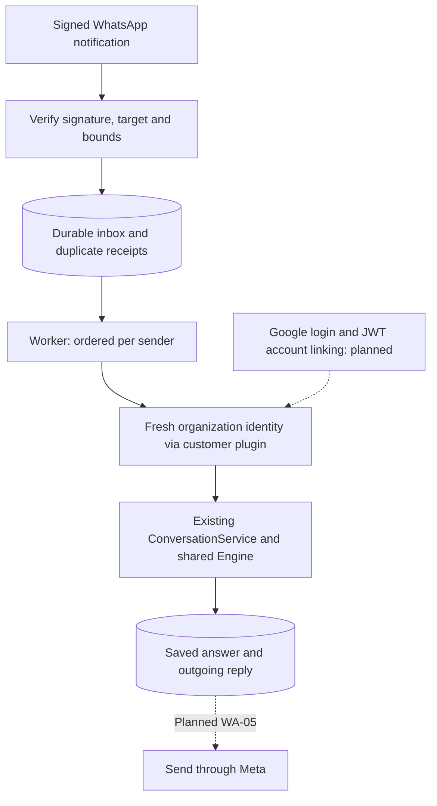

# WhatsApp implementation explanation and review

Review date: 2026-10-16. Scope: the uncommitted WA-01–WA-04 implementation,
tasks 0013–0016, reviewed and hardened in
[task 0017](../tasks/0017-whatsapp-review-and-hardening.md), plus the bounded
test-resource follow-up in [task 0018](../tasks/0018-sql-test-resource-cleanup.md).

## 1. Summary

The implemented path receives authenticated notifications, stores them before
acknowledging, resolves the sender through a required customer identity plugin,
and runs the existing Extra conversation service. It persists the assistant's
answer and stages an immutable outgoing reply. Actual provider sending,
Google/JWT account linking, and production setup remain unfinished.

| Stage | What exists | Why it matters |
| --- | --- | --- |
| WA-01 | Optional idempotent turn preparation, original history and run IDs, atomic receipts in memory/SQL. | Retrying queue bookkeeping does not add a second user turn. Preparation itself is not permission to execute again. |
| WA-02 | SQL inbox, sender/conversation binding, execution claim, immutable outbox, generic identity resolver port. | Serializes a sender's messages, keeps different senders separate, and requires an organizational identity before internal work. |
| WA-03 | Opt-in GET/POST webhook, challenge verification, HMAC over original bounded bytes, typed batches and safe quarantine. | HTTP success follows a complete durable commit. Invalid siblings can be isolated; delivery observations do not become agent input. |
| WA-04 | Opt-in supervised worker, exclusive connection ownership, fresh identity, existing manager streaming, stored-answer recovery. | Uses the engine built at startup; uncertain executions stop for review instead of rerunning tools. |

The worker requires a trusted `module:Class` identity implementation and the
configured organization. This is an extension point, not a deployed login
service. A WhatsApp sender ID or a Meta signature never grants employee roles.
The webhook and worker default off. Migrations 0007–0009 are required for the
corresponding SQL features; this review adds no migration.

## 2. Blocking issues

Three concrete issues were reproduced and fixed before the review recommendation.

### P1 — Cancelling shutdown released ownership before engine cleanup

Location: [worker.py](../src/agent_manager/application/channels/worker.py),
`ChannelWorker.__aexit__`.

Before: cancellation of the caller awaiting shutdown entered its `finally`
and closed the ownership stack while the shielded driver was still draining.
A second supervisor could acquire the same connection while the old engine
stream remained active. The previous slow-drain tests cancelled the driver,
so they did not cover cancellation of the lifespan caller itself.

After: the entire drain-and-release sequence runs in an owned shutdown task.
The caller shields and joins that task through repeated cancellation, then
propagates cancellation. Ownership remains held until stream cleanup and
durable interruption bookkeeping finish. Existing bounded drain behavior is
preserved; cleanup can exceed that budget to maintain exclusivity.

The regression test uses the actual local SQLite POSIX lock and a blocked fake
engine finalizer. Both single- and repeated-cancellation cases failed before
the change because a competing owner entered early, then passed after it.

### P2 — Unpersistable text could poison a complete webhook transaction

Location: [models.py](../src/agent_manager/domain/channels/models.py),
`bounded_identifier` and `bounded_text`.

Before: a signed JSON message or status containing U+0000 passed normalized
validation. SQLite accepts it, so the existing storage tests did not expose
the PostgreSQL failure. PostgreSQL character columns cannot store NUL; a write
would roll back valid siblings and yield retryable HTTP 503 for the same poison
batch. This storage restriction is documented in the
[official PostgreSQL character-type reference](https://www.postgresql.org/docs/17/datatype-character.html).
The batch failure consequence follows from our atomic intake transaction; it
was not tested against a live PostgreSQL server.

After: the shared normalized channel boundary rejects NUL in identifiers and
text before persistence. Existing normalization converts that validation
failure into safe quarantine metadata and preserves valid message/status
siblings. Outbox staging rejects an invalid part before writing any part or
releasing its sender. Valid Unicode, line breaks, and exact text remain intact;
input is not silently rewritten.

Nine new failing cases demonstrated missing rejection: three inbound fields,
three status fields, two normalized-domain cases, and atomic reply staging.
They passed after the two boundary validators were corrected.

### P2 — Ownership failure remained healthy during slow cleanup

Location: [worker.py](../src/agent_manager/application/channels/worker.py),
`ChannelWorker._serve` and its public `running` property.

Before: after ownership verification failed, the driver awaited child cleanup
before its task became done. During slow cleanup, `running` remained true and
the existing health route could still return HTTP 200. This concealed a failed
supervisor from readiness monitoring even though it could no longer claim work.

After: a fatal driver exception sets the stop signal before awaiting cleanup.
The public liveness property and the existing `/health` mapping therefore report
failure immediately, while shutdown continues to await child cleanup safely.
A regression holding the engine finalizer open failed before this correction
and passed afterwards. The HTTP response contract itself is unchanged.

No unresolved blocking finding remains within the implemented WA-01–WA-04 scope.
This conclusion does not establish readiness for a live internal-information
pilot; its missing components are listed below.

## 3. Non-blocking issues

These are remaining delivery stages, not implemented features:

- WA-05: send the outbox through Meta, preserve reply/part order, distinguish
  accepted from delivered, handle retries and uncertain delivery, and recheck
  authorization immediately before delayed delivery.
- Complete the trusted Google/JWT login and revocable sender/account mapping.
  Test actual organization access and tool/data permissions through that plugin.
- Implement reset/help/opt-out behavior and unsupported-media feedback; storage
  reset support alone is not a user-facing command. Approvals currently cause
  cancellation or review, with no WhatsApp approval experience.
- WA-06/account preflight: actual account compatibility, administrator setup,
  operational review/recovery procedures, and a controlled full round trip.

An item in `needs_review` deliberately retains its sender claim. There is no
operator review UI or automatic ambiguous-run replay. The outbox currently
contains saved replies, with no provider delivery guarantee.

The full gate also exposed a separate test-resource defect, corrected in task
0018: repository-contract fixtures and SQL conversation-creation helpers owned
engines without disposing them. Test fixtures now close their engines in
`finally`, including when assertions or setup fail. Separate engine instances
are retained for the existing concurrency tests; product code is unchanged.

## 4. Architecture concerns

Verdict: conforms within scope. Transport, persistence, worker supervision, and
conversation lifecycle belong to `agent_manager`; the engine has no WhatsApp
imports. Startup builds the engine once, while principals and execution context
remain per request. The worker calls the existing service rather than its own
HTTP endpoints. YAML validation/compilation and public engine, plugin, and
conversation HTTP contracts are unchanged by this review.

The corrections enforce existing decisions in ADRs 0007–0009; a new contract
ADR is unnecessary. ADR 0009 now explicitly describes cancellation of the
shutdown caller. SQLite ownership requires local POSIX storage. PostgreSQL
ownership requires a dedicated persistent session, not transaction pooling.

Older project-wide status prose says that identity projection into the engine
is missing. Current code already projects `Principal` into `RunContext`, then
non-secret identity into graph state, with access tests. That older prose is
not evidence that WhatsApp account linking exists; see the
[plan's identity section](WHATSAPP_INTEGRATION_PLAN.md#5-identity-and-protected-resources).
No engine rewrite was needed for this integration review.

## 5. Security concerns

Reviewed boundaries: original-byte signature checking before parsing, target
account/number isolation, bounded input, no browser-auth dependency on webhook
routes, fresh same-organization identity before execution and answer staging,
binding ownership continuity, and sanitized plugin/storage failures. Channel
rows do not persist resolved credentials or role claims. Prompt text is not
used as an authorization boundary.

Internal deployment still requires a real client identity/access implementation
and enforcement at the tool/data layer. The future sender must reauthorize the
original recipient rather than redirect an old reply after account relinking.
Reviewing generic boundaries and fake credentials is not verification of the
customer's eventual login, permissions, or Meta account.

## 6. Testing gaps

The new regression cases exercise real local file SQLite, actual POSIX locks,
public manager/channel methods, controlled cancellation, and fake engine and
identity adapters. Existing suites cover receipt concurrency/rollback/restart,
owner and organization isolation, HTTP signatures and limits, malformed batch
isolation, migrations, sender ordering, answer recovery, approvals, and startup.

No live PostgreSQL server, Meta account, model, MCP server, Google login, JWT
issuer, production database, or real phone number was used. PostgreSQL ownership
has controlled connection-contract tests; backend deployment verification and
the complete outbound round trip remain pending. The NUL restriction was
checked against the official database reference, with local boundary tests.

Final `make check` passed: **1,327 tests**, 24 baseline dependency-warning
instances, formatting for 339 files, lint, mypy for 335 files, and generated-stub
checks. Whitespace and local documentation links/anchors passed. New coverage
in this review totals twelve regression cases.

Early full gates also reported intermittent aiosqlite worker-thread exceptions
(`Event loop is closed`), sometimes during unrelated later tests. Creation-site
diagnostics traced unclosed engines to the two older test modules corrected in
task 0018. A deterministic local diagnostic retaining connection objects showed
38 of 42 connections still open before that correction, and zero of 42 after
it; all 61 tests in those modules passed. No warning filter or dependency change
was used to conceal the defect. The final full-gate result is recorded in tasks
0017/0018; the final run contained no closed-loop aiosqlite thread warning.

## 7. Suggested improvements

Keep the next implementation focused on WA-05 outbound delivery and controls,
including a fake-provider full round trip. Build customer account linking as a
separate trusted integration before enabling internal access. Keep the existing
review-stop behavior for uncertain executions until an operator recovery design
is implemented; do not add an expiring lease that reruns tool effects.

Files changed by this review:

- `src/agent_manager/application/channels/worker.py`
- `src/agent_manager/domain/channels/models.py`
- `tests/agent_manager/test_channel_worker.py`
- `tests/agent_manager/test_channel_storage.py`
- `tests/agent_manager/test_whatsapp_normalization.py`
- `tests/agent_manager/test_repository_contract.py` and
  `tests/agent_manager/test_sql_conversation_creation.py` (task 0018 cleanup).
- This review, `docs/README.md`, `docs/WHATSAPP_INTEGRATION_PLAN.md`, and
  `docs/adr/0009-channel-worker-ownership-and-recovery.md`.
- `tasks/0017-whatsapp-review-and-hardening.md`,
  `tasks/0018-sql-test-resource-cleanup.md`, and `tasks/README.md`.

## 8. Final recommendation

Approve the implemented stages with the three corrections, regression coverage,
test-resource cleanup, and the passing full gate recorded in task 0017. Provider sending,
trusted account linking, and pilot deployment remain subsequent work. No commit,
PR, account setup, or deployment was performed in this review.
